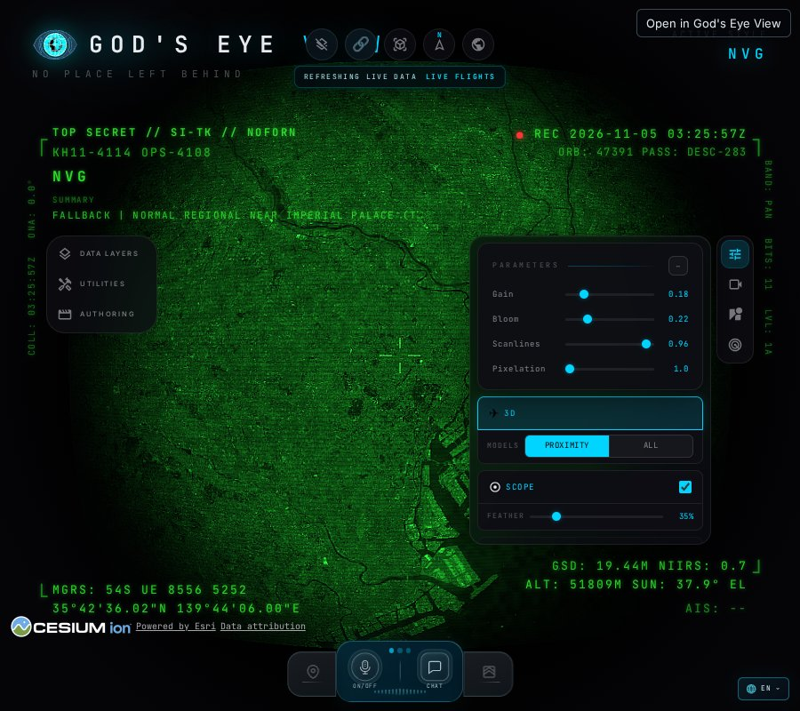
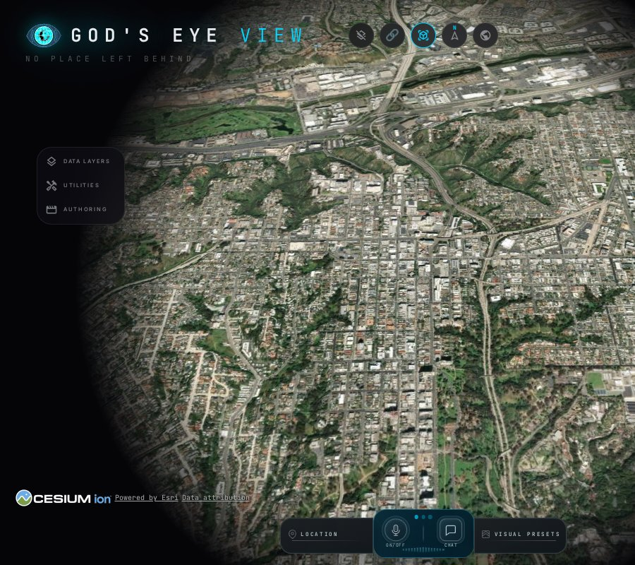
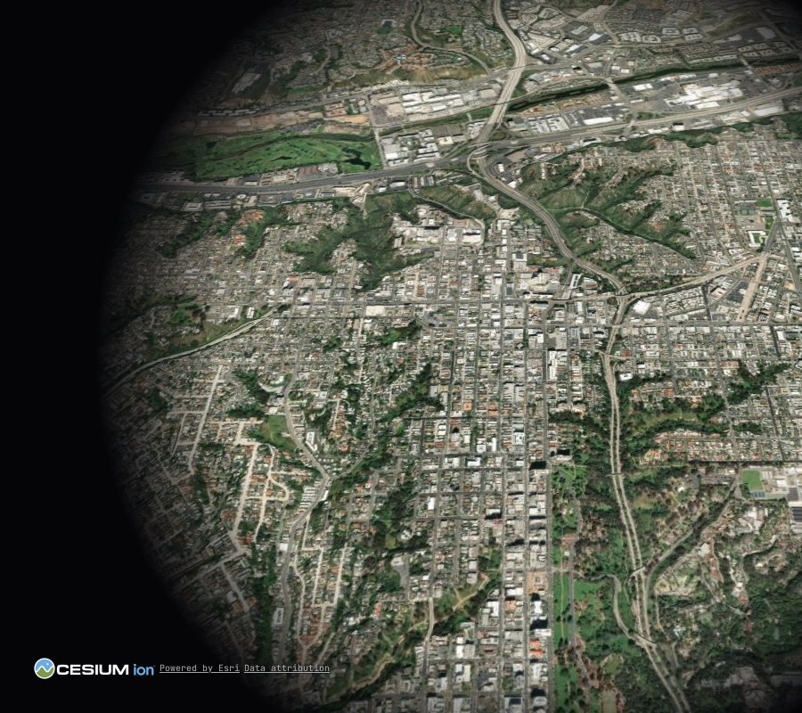
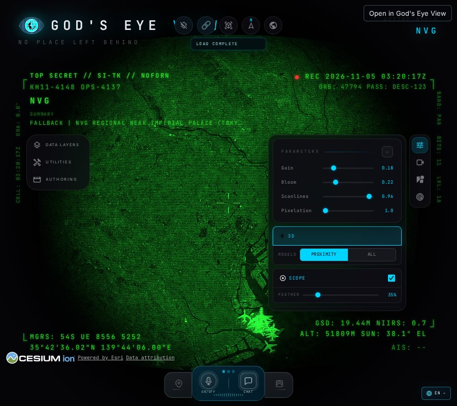
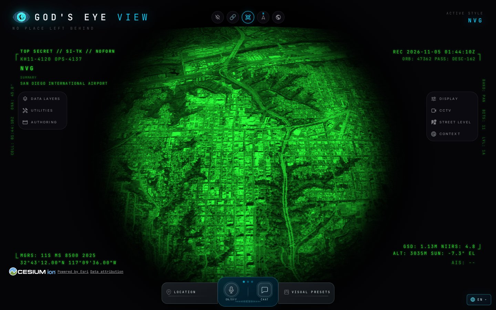
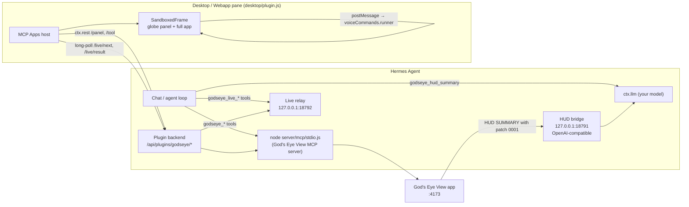

<div align="center">

# 🌐 hermes-godseye

**[God's Eye View](https://github.com/bilawalsidhu/gods-eye-view) inside [Hermes Agent](https://github.com/NousResearch/hermes-agent).**
A live 3D globe of public aircraft, ships, satellites, hazards and weather in a Hermes pane, which Hermes can control and answer questions about. Inference comes from your Hermes model, not OpenAI.

[Install](#install) · [Features](#features) · [Try it](#try-it) · [Architecture](#architecture) · [Config](#configuration) · [Troubleshooting](#troubleshooting)



<sub><i>"Fly to Tokyo and switch to night vision, then tell me what I'm looking at." The command ran in <code>hermes chat</code> and drove the live pane.</i></sub>

</div>

---

## Features

| | |
| --- | --- |
| 🛰️ **Data tools** (29 `godseye_*`) | God's Eye View's MCP tools for flights, vessels, satellites and passes, earthquakes, fires, weather, infrastructure, OSM places and imagery search. Each one is a Hermes tool and is backed by the upstream MCP server. No pane is needed. |
| 🎮 **Live globe control** (33 `godseye_live_*`) | Hermes drives the globe **open in your pane** using God's Eye View's own voice-agent action runner. It can fly to a place, toggle layers, set the visual style (NVG, thermal, …), annotate the map, move the camera, follow aircraft, ships or satellites, play scenes, and run analyst queries such as "how many flights are in view?". It can also read the current view state. If no pane is open, the tool says so. |
| 🧠 **HUD summaries via Hermes** | `godseye_hud_summary` builds upstream's own HUD prompt and runs it on **your active Hermes provider/model** (`ctx.llm`). With [patch 0001](#upstream-patches) the app's built-in SUMMARY overlay uses Hermes too. |
| 🖥️ **Desktop and Webapp pane** | God's Eye View's MCP Apps globe panel runs in the SDK's sandboxed frame (opaque origin, no `allow-same-origin`). It works in native Hermes Desktop and in the browser Webapp. With [patch 0002](#upstream-patches) you get the **full app UI** (layers, styles, HUD). On stock upstream you get the clean globe. |
| 🔇 **Voice off** | Hermes has no realtime-audio lane for plugins, so the app's OpenAI/Gemini voice stays unused unless you give the app its own key. Hermes chat is the "voice". |

<table><tr>
<td><br><sub>Full UI in the pane (patch 0002)</sub></td>
<td><br><sub>Globe only (stock upstream)</sub></td>
</tr><tr>
<td><br><sub><code>godseye_live_fly_to_location</code> → Tokyo</sub></td>
<td><br><sub>In-app HUD SUMMARY written by Hermes (patch 0001)</sub></td>
</tr></table>

## Try it

- "What am I looking at in God's Eye View?"
- "Fly to Tokyo and switch to night vision."
- "Turn on the ships layer and frame the port of Rotterdam."
- "How many flights are in view right now? Which is highest?"
- "Mark the three largest airports in Japan on the map."
- "Any earthquakes above M5 in the last day?" (works without the pane)
- "When does the ISS next pass over me?"

## Install

**Requirements**
- Hermes Agent with plugin support. The pane needs Hermes Desktop or the Webapp.
- **Node 24.14+**. Upstream recommends 24.22.1+.
- A **God's Eye View checkout running**, by default at `~/gods-eye-view` on `http://localhost:4173`.

```sh
# 1. God's Eye View
git clone https://github.com/bilawalsidhu/gods-eye-view ~/gods-eye-view
cd ~/gods-eye-view && npm ci && npm run build:panel && npm run dev     # http://localhost:4173

# 2. The plugin
hermes plugins install mojomast/hermes-godseye
hermes plugins enable godseye
hermes plugins doctor godseye
```

You can also open the one-click link **`hermes://plugin/install?repo=mojomast/hermes-godseye`**.

Then, in Hermes Desktop or the Webapp:
1. Go to **Capabilities → Plugins → Rescan**.
2. Enable **God's Eye View**. The pane is opt-in.
3. Start a new chat so Hermes picks up the globe system-prompt note.

For an always-on app, `scripts/install-service.sh` installs God's Eye View as a user systemd service. The service loads the plugin's HUD bridge env, so the in-app HUD uses Hermes when patch 0001 is applied.

## Upstream patches

Two small, **opt-in** upstream changes enable the extras. Both leave default behavior unchanged. They are proposed upstream and also shipped here in [`patches/`](patches) (MIT, © their authors, same license as God's Eye View):

| Patch | Upstream PR | Enables |
| --- | --- | --- |
| `0001-hud-summary-compatible-endpoint.patch` | [bilawalsidhu/gods-eye-view#1571](https://github.com/bilawalsidhu/gods-eye-view/pull/1571) | `GEV_HUD_SUMMARY_BASE_URL`: the app's own HUD SUMMARY overlay via Hermes |
| `0002-embed-full-ui.patch` | [bilawalsidhu/gods-eye-view#1572](https://github.com/bilawalsidhu/gods-eye-view/pull/1572) | `GEV_EMBED_FULL_UI`: the full app UI in the pane |

```sh
cd ~/gods-eye-view
git am /path/to/hermes-godseye/patches/*.patch     # or: git apply
npm run build:panel                                 # rebuild the panel the pane loads
```

**On stock upstream the plugin still works.** The pane shows the clean globe and hides the Full UI toggle; `/status` reports `patched.fullUi=false`. `godseye_hud_summary` still runs on Hermes, and live control and data tools behave the same. Only the in-app SUMMARY overlay falls back to upstream's OpenAI-or-keyless behavior.

## Architecture



- **Data tools** come from a snapshot of the upstream MCP catalog (`gev/tools_snapshot.json`). They call one persistent `node server/mcp/stdio.js` child.
- **Live tools** come from upstream's realtime action catalog (`gev/live_tools_snapshot.json`).
  1. A tool call is queued on a loopback relay.
  2. The open pane long-polls it through the plugin backend and posts it into the frame.
  3. A small injected script runs it with `window.__godsEyeView.voiceCommands.runner`, the same code path as voice.
  4. The result travels back the same way.
- **Pane**: God's Eye View's own MCP Apps panel, loaded as a `data:` document through `panel_request`. It needs no framing headers, CORS changes or `allow-same-origin`. A small Blob/Worker shim lets Cesium's workers run inside the opaque-origin frame.

## Configuration

All settings are optional environment variables, for example in `~/.hermes/.env`.

| Variable | Default | Purpose |
| --- | --- | --- |
| `GODSEYE_HOME` | `~/gods-eye-view` | God's Eye View checkout (MCP server, patch detection) |
| `GODSEYE_API_BASE` | `http://localhost:4173` | Where the app is reachable from Hermes |
| `GODSEYE_PUBLIC_URL` | = API base | Browser-reachable app URL for "Open full app" and links (e.g. a LAN/VPN name) |
| `GODSEYE_NODE` | `~/.local/node24/bin/node`, then `node` | Node 24.14+ binary |
| `GODSEYE_HUD_BRIDGE` | on | `0` disables the loopback HUD bridge |
| `GODSEYE_BRIDGE_PORT` | `18791` | HUD bridge port |
| `GODSEYE_LIVE_PORT` | `18792` | Live-globe relay port |
| `GODSEYE_BIND` / `GODSEYE_NODE_DIR` | `127.0.0.1` / `~/.local/node24` | `install-service.sh` only |

If the app is reached by a non-localhost name, add that name to God's Eye View's `GEV_ALLOWED_HOSTS`.

## Security and sandbox

- The pane uses the Desktop Plugin SDK's `SandboxedFrame`: an opaque origin with `allow-scripts` only. The plugin never adds `allow-same-origin`.
- The frame reaches the app only through the plugin backend. Only `panel_request` and `show_in_gods_eye_view` are allowed there.
- The live-control script inside the frame accepts messages only from its parent window. Hermes can run only the listed upstream actions.
- The HUD bridge and live relay listen on **127.0.0.1 only** and require a random bearer token. The token is stored in `~/.hermes/plugin-data/godseye/hud-bridge.env` (mode 0600). The plugin holds no model API keys; inference goes through `ctx.llm`.

## What it runs (disclosure)

- **Processes:** a single `node server/mcp/stdio.js` child from your God's Eye View checkout. It is started on first tool use and runs with an argument list, not a shell. `scripts/install-service.sh` is optional and is never run by the plugin.
- **Background threads** run in the Hermes dashboard/gateway process: the loopback HUD bridge (`127.0.0.1:18791`) and the live relay (`127.0.0.1:18792`).
- **Network:** the plugin talks only to your God's Eye View app (`GODSEYE_API_BASE`) and to loopback. The app itself fetches public data from the providers listed in its DATA_SOURCES.md.
- **Files:** the plugin writes only `~/.hermes/plugin-data/godseye/hud-bridge.env` (0600: loopback URL plus a random token). It reads its own files and your God's Eye View checkout (to detect patches). It reads no `.env`, auth or credential stores, and holds no API keys.
- **Pane:** the panel document gets four small additions from the backend (`gev/panel_inject.py`): a `<base>`, the full-UI flag, a Cesium worker shim, and the live agent. These run **only inside the sandboxed frame**, never in the Hermes renderer.
- No telemetry and no self-update.

## Responsible use

God's Eye View is built on **public, aggregate data**: aircraft, vessels, satellites, hazards, weather and infrastructure. This plugin keeps the project's line: **no named-person search, no face recognition, no locating or tracking individuals.** Every tool description says so, and `gev/policy.py` refuses such requests before they reach the app. Following an aircraft, vessel or satellite by its public identifier is supported; following a person is not.

**Data-source terms:** every layer comes with its provider's terms and attribution. See upstream [DATA_SOURCES.md](https://github.com/bilawalsidhu/gods-eye-view/blob/main/DATA_SOURCES.md). Some sources are non-commercial or need your own key.

## Troubleshooting

| Symptom | Fix |
| --- | --- |
| Pane says "app not running" | Start God's Eye View (`npm run dev`) and check `GODSEYE_API_BASE`. |
| Blank or black globe | Run `npm run build:panel` in the checkout, then hard-refresh the Webapp. |
| No Full UI toggle | Stock upstream: apply `patches/0002` and rebuild the panel. |
| Hermes says "no God's Eye View pane is open" | Open the pane (Capabilities → Plugins → God's Eye View) and keep it visible, then retry. |
| `relay_unavailable` | Restart the Hermes dashboard/gateway so the plugin backend starts the relay. |
| "Open full app" goes to localhost | Set `GODSEYE_PUBLIC_URL` and allow the name in `GEV_ALLOWED_HOSTS`. |
| Plugin changes not showing | Rescan plugins, toggle the pane, hard-refresh. |

## Limitations

- Live control needs the pane open and loaded. A command not picked up within ~8 s reports "no pane". With several panes open, the first one to poll runs the command.
- The in-app HUD needs place labels (a Google basemap or Places key) before it asks for a summary. Without them it shows its plain fallback line.
- Some layers and lookups need the keys upstream asks for. See its `.env.example`.
- The tool snapshots must be refreshed when upstream changes its catalogs (`scripts/snapshot_tools.sh`).

## Development

```sh
python3 -m pytest -q tests                      # unit tests
GODSEYE_E2E=1 python3 -m pytest -q tests        # plus a live call against npm run dev
```

## Credits and license

- **[God's Eye View](https://github.com/bilawalsidhu/gods-eye-view)** by Bilawal Sidhu and contributors, MIT. Its license is included as [`LICENSE.upstream-gods-eye-view`](LICENSE.upstream-gods-eye-view). This plugin reuses its MCP server, panel, voice actions and HUD prompt. It is an independent integration, not affiliated with or endorsed by the upstream project.
- **hermes-godseye** © mojomast, [MIT](LICENSE).
