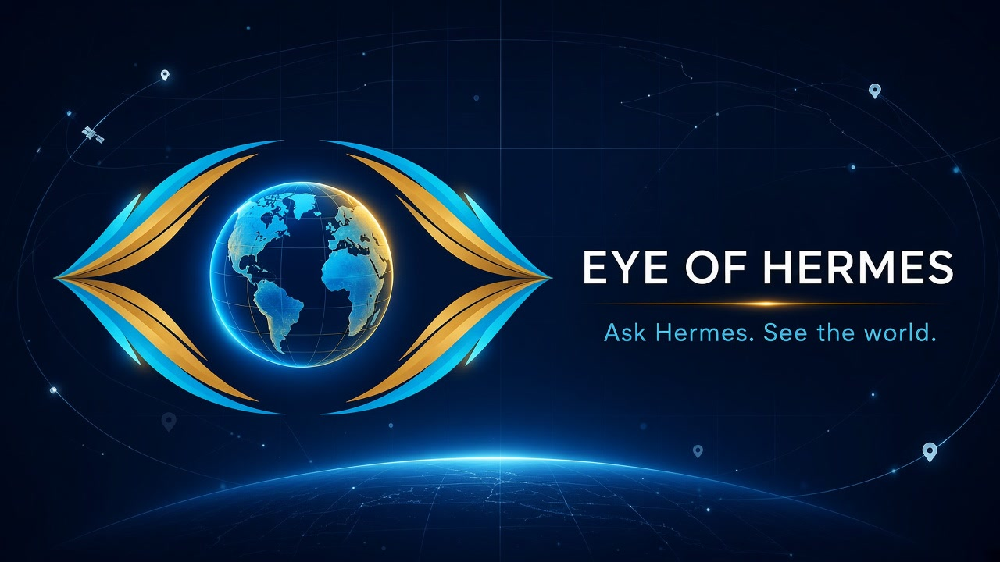
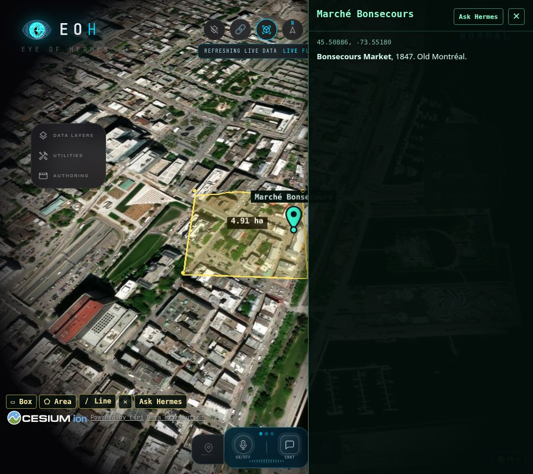
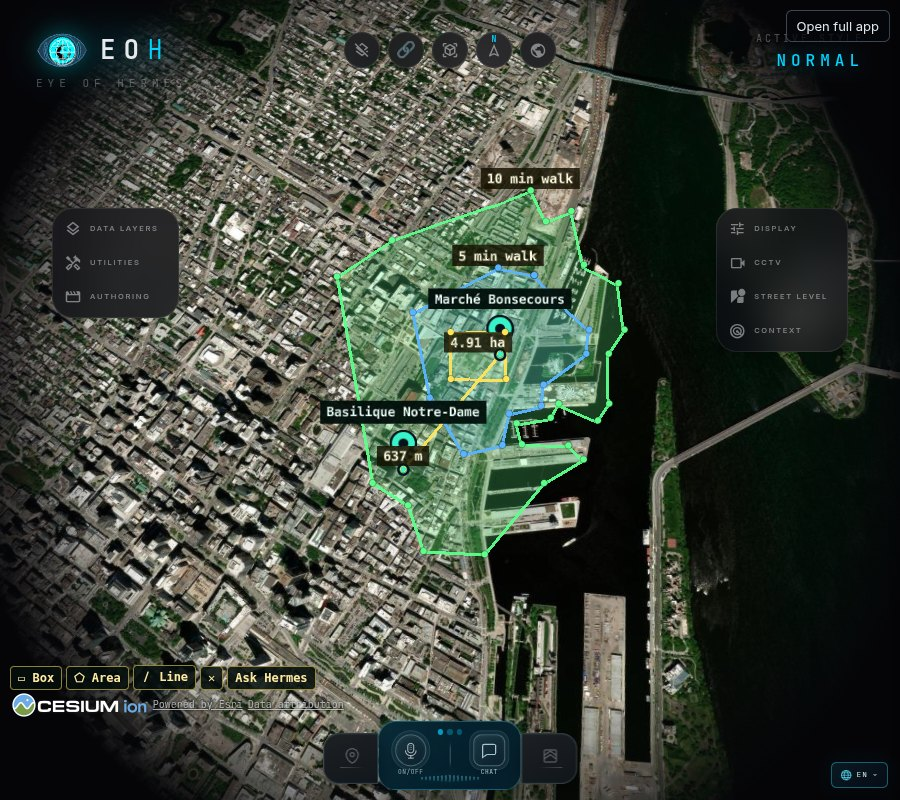
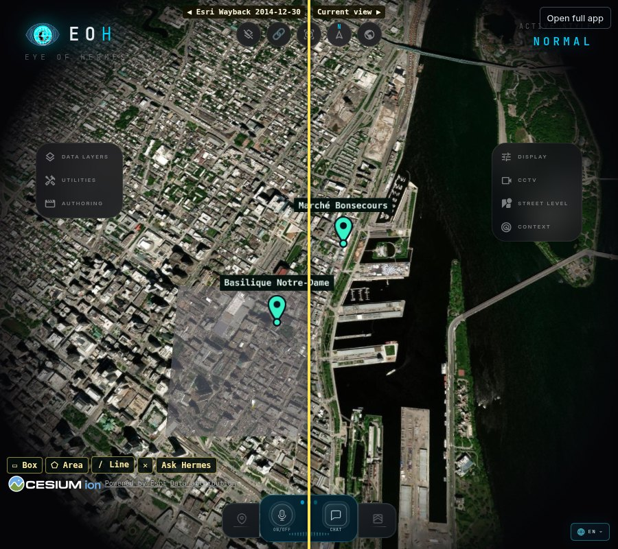
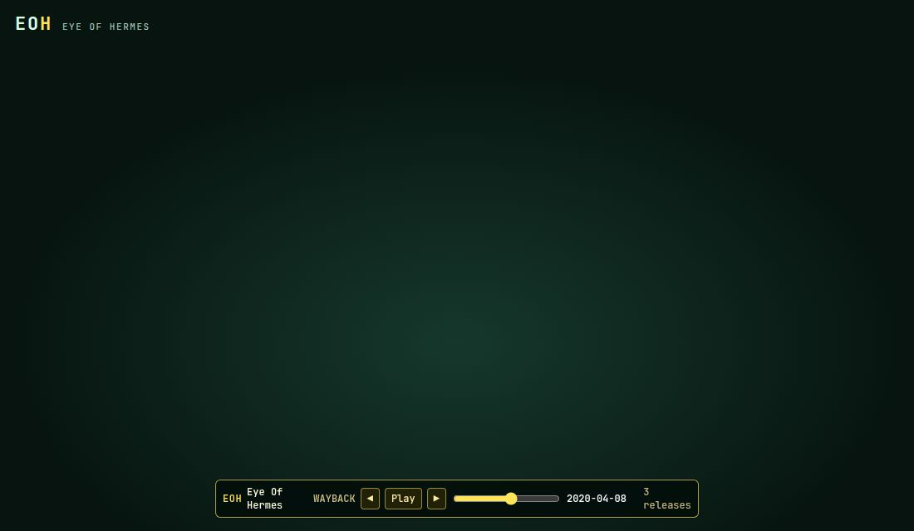
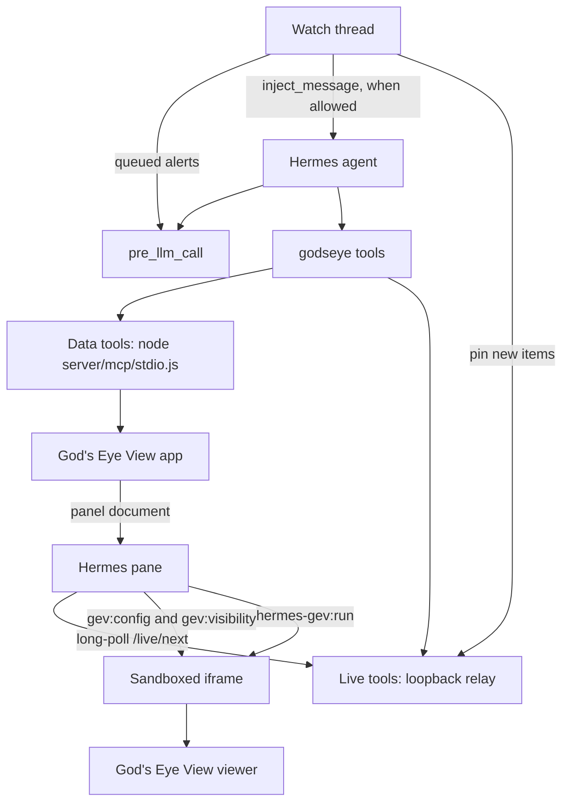

<div align="center">

# Eye Of Hermes

**A live 3D globe in the Hermes pane, which the agent can fly, measure, and watch.**

Eye Of Hermes (EOH) is the Hermes plugin `godseye` (version 0.2.0). It runs a [fork of God's Eye View](https://github.com/mojomast/gods-eye-view) beside the chat and gives Hermes the tools to drive it. Answers come from your Hermes model.

[Tour](#a-tour-of-the-pane) · [How it works](#how-it-works) · [Quick start](#quick-start) · [Tools](#tools) · [Privacy](#privacy-and-responsible-use)

</div>

---

## What it is for

Hermes can talk about a place. A list of coordinates is a poor way to show one. [God's Eye View](https://github.com/bilawalsidhu/gods-eye-view), by Bilawal Sidhu, already has the globe: public aircraft, ships, satellites, earthquakes, fires, weather, and a photorealistic city. Eye Of Hermes puts that globe in a Hermes Desktop or Webapp pane and registers its actions as tools, so the same chat that answers a question can move the camera, pin what it found, and leave a watch running.

The live commands go through God's Eye View's own voice-action runner. There is one globe. The agent drives the same path the app already uses for voice.

A few things make that usable in a long chat:

- Before each model turn, Hermes can receive one short map line: whether the pane is connected, busy, or closed, plus camera center, range, pitch, heading, active layers, pin count, and the open drawer. The line is built from the relay's cached snapshot. It does not call the pane, so a busy globe is left alone. `GODSEYE_TURN_STATE=0` drops the line. Hosts without `pre_llm_call` skip it, and the tools still work.
- Large tool results default to ids and counts. Pass `detail=full` when you need the rows, the geometry, or an image.
- A failed call comes back as `code`, `message`, and `fix`. The fix is the next action (open the pane, retry the same call, rebuild the panel), and the agent is told to follow it.
- The pane is kept alive across layout changes, so resizing the window does not construct a new WebGL context on every move. On the fork, a hidden pane pauses the viewer. A lost WebGL context is recovered in the same pane. Recovery is on unless `GODSEYE_GL_RECOVER=0`. After 3 losses in 20 seconds it stops and shows **Click to reload the globe**.

Person search, face recognition, and tracking an individual are refused in `gev/policy.py` before a call reaches the app. Following an aircraft, ship, or satellite by its public identifier is a normal tool.

## A tour of the pane

The pictures are the running pane over Montreal. The names and coordinates are public places. Imagery credits in the corner (Cesium ion, Esri) belong to those providers, through God's Eye View.

### What am I looking at

`godseye_query` with `op=context` reads the camera, the visible box, the selected pin, the last clicked ground point, and any shape on the map. `focus` is its best guess for "this": the open pin, then the newest drawing, then the last click, then the centre of the screen. It reverse-geocodes that point and lists nearby named places. `op=what_is_here` does the same lookup for a lat/lon with no pane open.

The toolbar at the bottom left draws a box (two clicks), an area, or a line. Distance and area are labeled on the shape. **Ask Hermes** copies a ready question to the clipboard and focuses the chat composer. The Desktop plugin SDK cannot submit a chat message on its own, so you paste and send.



<sub>A drawn box of 4.91 ha around Marché Bonsecours. The drawer shows 45.50886, -73.55180 and "Bonsecours Market, 1847, Old Montréal." <b>Ask Hermes</b> is on the drawer and on the draw toolbar.</sub>

### Measure, routes, and reach

`godseye_nav` `op=measure` returns great-circle distance (each leg, with bearings), the area and perimeter of a polygon or box, or a walk, bike, or drive route. Routes use the public OSRM server. `godseye_nav` `op=isochrone` draws reach rings from the public Valhalla server. If Valhalla is down, one OSRM `table` call (16 bearings, 4 distances) builds a polygon and marks it `approximate`. If both are down, the tool returns `routing_unavailable`. It does not substitute a straight-line circle.



<sub>Walking reach from the market: 5- and 10-minute isochrones, the 4.91 ha box, and a 637 m measurement, with pins on Marché Bonsecours and Basilique Notre-Dame.</sub>

### Before and after

`godseye_nav` `op=compare` splits the view. Each side is `current`, `osm`, or `wayback:YYYY[-MM[-DD]]` (Esri World Imagery Wayback, a keyless WMTS). A date selects the release on or before that day. `action=list_dates` lists releases. God's Eye View shows one map stack at a time, so two stacks cannot be split, and photorealistic 3D tiles are hidden while the swipe is up, because they draw above the imagery. Wayback dates are release dates; the photo under a spot can be older than the label.



<sub>Left: <b>Esri Wayback 2014-12-30</b>. Right: <b>Current view</b>. The pins stay on Marché Bonsecours and Basilique Notre-Dame. Drag the divider to move the split.</sub>

### Time slider

`godseye_nav` `op=timeline` puts a play, pause, and step control on the pane. The sub-action is an argument named `timeline`: `set`, `play`, `step`, `stop`, `state`, or `list_dates`.

`timeline=set` with `mode=wayback` lists the Esri World Imagery Wayback releases in the window (`from` and `to`, `YYYY-MM-DD`) and scrubs them over the current view. `transition` is `swipe` (the default) or `fade`. `timeline=list_dates` returns those release dates. The catalog is cached for six hours and is not fetched again inside two seconds. A release date is when Esri published the mosaic. The photo under a spot can be older. The tiles are for viewing only.

`mode=events` shows USGS earthquakes and NASA FIRMS fires, plus alerts already stored by an area watch, as pins. A pin appears when the playhead reaches its time, and it opens the same drawer as any other pin. Omit `from` and `to` to use the last 7 days. `feeds` is `earthquakes`, `fires`, or both. `area` is `[south, west, north, east]`. Omit it to use the open view. FIRMS' area API covers the last 10 days. Older fires in the window come from the watch history.

`timeline=play` runs the slider. `timeline=step` with `by=1` or `by=-1` moves one release, or one event day. `timeline=state` reads the date and what is visible. `timeline=stop` pauses. The slider is saved with the scene and with an investigation, and it comes back when the pane reopens or WebGL recovers. Dragging the control saves the playhead the same way a filter chip does. Photorealistic 3D tiles are hidden while Wayback imagery is up. They are not sampled.



<sub>Wayback playhead on <b>2020-04-08</b>, three Esri releases in the window. Play, step, and the range sit on the EOH pane.</sub>

### Also on the globe

- **Pins.** Annotation pins, place pins, brief hits, and tour stops are ground-clamped markers. The tip is the point, a dot sits on the ground under it, and the height is sampled again as the camera's level of detail changes. Click a pin, or call `godseye_annotate` `op=drawer`, for a drawer of title, `description_md` (markdown; raw HTML is shown as text), images, and http(s) links. The open drawer is saved with the scene.
- **Clusters and filters.** Above a camera height of 2,500 m, pins within 56 screen pixels merge into a count bubble. Click it, or `godseye_annotate` `op=filter` with `action=expand`, to zoom in. A chip bar filters by category (OSM `amenity`, `shop`, `tourism`, `leisure`, `cuisine`), by rating, and by **Open now**. Open now understands a subset of OSM `opening_hours`: `24/7`, weekday ranges and lists, overnight spans, and `off`, with a later rule replacing earlier ones. Anything else is unknown, and unknown pins stay visible unless `include_unknown` is false. The clock is the pane's local time.
- **Research and investigations.** `godseye_annotate` `op=research` fills drawers from Wikipedia, Wikidata, Wikimedia Commons, OSM tags already on the pin, and a site's meta description. Missing sources are marked unavailable. `godseye_scene` `op=save`, `op=load`, `op=list`, and `op=delete` store a named scene. `op=report` writes HTML and Markdown under `plugin-data/godseye/reports/`, with a map image when the pane can read its canvas. `godseye_scene` `op=export` writes that investigation, or the current scene when `name` is omitted, under `plugin-data/godseye/exports/`. `format` is `geojson`, `kml`, `both` (the default), or `pack`. GeoJSON is RFC 7946 with longitude then latitude. Pins are points and carry their drawer and enrichment properties. Drawings and areas are polygons or lines. Routes are lines. `pack` is a zip of the GeoJSON, the KML, the Markdown report, and any saved screenshots. Google photorealistic tile imagery is left out of the files. `/gev export` runs the same export.
- **Area watches.** `godseye_watch` `op=create` polls an area for earthquakes (USGS), fires (NASA FIRMS), flights (OpenSky), ships (through the app), or OSM places. The first run records what is already there. Later runs alert only on ids that have not been seen, pin the new items, and queue a message for the next chat turn. With `deliver=inject`, the plugin also calls `ctx.inject_message` when Hermes is configured to allow it.
- **Brief and show, home, share, tours.** `godseye_query` `op=brief_and_show` runs a situation brief (or military awareness when the question is about military activity), flies there, turns on the brief's layers, and pins the top hits. `godseye_view` `op=home` saves a view and opens a cold pane there. `op=share` builds a `/share/<code>` link with God's Eye View's share codec, or a camera-hash URL when that codec cannot run. `godseye_scene` `op=tour` flies a list of stops in the background.

## How it works



**Data tools** are a snapshot of God's Eye View's MCP catalog (`gev/tools_snapshot.json`). They call one persistent `node server/mcp/stdio.js` child. No pane is required. `panel_request` is in the upstream catalog and is deliberately not registered as a model tool.

**Live tools** are a snapshot of the app's realtime actions (`gev/live_tools_snapshot.json`), plus the tools this plugin adds (context, draw, measure, compare, pins, watches, investigations).

1. A live call is queued on a loopback relay, `127.0.0.1` port `GODSEYE_LIVE_PORT` (18792), with a random bearer token.
2. The open pane long-polls it through the plugin backend.
3. The pane posts `{type:'hermes-gev:run'}` into the iframe.
4. An injected script runs the action with `window.__godsEyeView.voiceCommands.runner`, the same runner voice uses, and the result comes back the same way.

A command no pane picks up within about 8 seconds returns `no_pane`. A pane still working on an earlier command returns `pane_busy`. Each pane keeps a stable id per chat session. A call goes to that pane, or to the most recently active one. `fanout: true` sends it to every open pane.

**Turn state and watches.** Hermes keeps one callback per hook name, so the map line and watch alerts share `pre_llm_call`. The text is the line, the alerts, or both, separated by a blank line. The line is at most 300 bytes and drops anything that looks like a key or a URL. A connected line has this shape (the numbers are an example, not a captured turn):

```text
EOH pane=connected cam=45.5089,-73.5518 r=800m p=-35.0 h=20.0 layers=flights pins=2 drawer=Marché Bonsecours
```

A closed pane is `EOH pane=closed`. Alerts look like `[EOH watch alert] <name>: <n> new item(s).`

Watches exist only when someone creates one. Hermes cron schedules model prompts, so the check itself runs in a daemon thread inside the Hermes process, and that thread runs only while a watch is active (`GODSEYE_WATCH_LOOP=0` stops it). Seen ids are stored, so a restart does not re-alert. `deliver=inject` also calls `ctx.inject_message` for that chat. Hermes accepts the injection when `plugins.entries.godseye.allow_gateway_injection` is true. Otherwise the alert stays queued for the next turn.

**Embed protocol.** A current God's Eye View build (the [mojomast fork](https://github.com/mojomast/gods-eye-view), documented in its `docs/EMBEDDING.md`) accepts two messages from the parent:

| Message | When the pane sends it | What the fork does |
| --- | --- | --- |
| `gev:config` | Before the viewer starts (`?waitForConfig=1`), with the client keys and `perf` | Applies keys and the performance profile, then replies `gev:config-applied` |
| `gev:visibility` | Page visibility and an intersection observer: hidden when the pane is covered or the tab is in the background | Pauses the render loop, HUD timers, and feed polls, then replies `gev:visibility-applied` |

The same keys are written to `dist/panel/config.json` in the God's Eye View checkout (mode 0600, gitignored there) and injected as `GEV_RUNTIME_CONFIG` in the panel HTML. `perf` is sent on the query string and in the message. It is not written into `config.json`. Changing a client key on a build that understands this protocol does not need `npm run build:panel`. Older builds still bake the keys; `godseye_admin` `op=rebuild` is for those. Server keys (`AISSTREAM_API_KEY`, `FIRMS_MAP_KEY`) stay in the env file.

The pane frame is the Desktop SDK's `SandboxedFrame`: an opaque origin, scripts allowed, `allow-same-origin` never added. App files the panel needs are loaded through the plugin backend, and that backend allows only `panel_request` and `show_in_gods_eye_view` from the pane. The viewer then requests imagery from the providers configured in the app. A worker shim lets Cesium's workers run in the opaque frame. Branding (`gev/panel_brand.js`) replaces the app's header wordmark with **EOH** / **EYE OF HERMES** and leaves the provider credits alone.

A second loopback, the HUD bridge on `127.0.0.1:18791`, lets the app's own SUMMARY overlay call Hermes when patch `0001` is applied. `godseye_capture` `op=summary` uses `ctx.llm` directly and does not need the bridge. Set `GODSEYE_HUD_BRIDGE=0` to skip the bridge. This plugin does not open the app's realtime voice session. Chat is the interface. The mic control in the pane belongs to God's Eye View, and it stays unused unless the app has its own key.

## Quick start

**You need**

- Hermes Agent, with Hermes Desktop or the Webapp for the pane.
- Node.js. God's Eye View documents 24.14 or later, or 26.x, and recommends 24.22.1 or later. This plugin's doctor checks that the major version is 24 or higher.
- A God's Eye View checkout. Use the [fork](https://github.com/mojomast/gods-eye-view) so the pane can send `gev:config`, `gev:visibility`, and `perf=embed`. The [upstream](https://github.com/bilawalsidhu/gods-eye-view) app still runs. Doctor reports when the HUD and full-UI patches below are missing.

```sh
# 1. The globe
git clone https://github.com/mojomast/gods-eye-view.git ~/gods-eye-view
cd ~/gods-eye-view && npm ci && npm run build:panel && npm run dev
# serves http://localhost:4173

# 2. The plugin
hermes plugins install mojomast/hermes-godseye
hermes plugins enable godseye
hermes plugins doctor godseye
```

The one-click install link is `hermes://plugin/install?repo=mojomast/hermes-godseye`.

Then enable **godseye** in Hermes Desktop or the Webapp, open the Eye Of Hermes pane, and start a new chat so the globe note is in the system prompt.

`scripts/install-service.sh` is optional. It installs the app as a user systemd service on `127.0.0.1:4173` and points it at the HUD bridge env file. The plugin never runs that script itself.

If doctor says the HUD or full-UI patch is missing, apply the opt-in patches in [`patches/`](patches) and rebuild the panel. Both leave upstream's default behavior unchanged when their env flags are unset.

| Patch | Upstream PR | What it unlocks |
| --- | --- | --- |
| `patches/0001-hud-summary-compatible-endpoint.patch` | [gods-eye-view#1571](https://github.com/bilawalsidhu/gods-eye-view/pull/1571) | The app's own HUD SUMMARY overlay, via `GEV_HUD_SUMMARY_BASE_URL` |
| `patches/0002-embed-full-ui.patch` | [gods-eye-view#1572](https://github.com/bilawalsidhu/gods-eye-view/pull/1572) | The full app UI in the pane, via `GEV_EMBED_FULL_UI` |

On a checkout without patch 0002 the pane shows the globe and hides the full-UI toggle. `godseye_capture` `op=summary` still runs on Hermes. Live control and the data tools behave the same. Only the in-app SUMMARY overlay falls back to the app's own path.

### Environment

No key is stored in this repository. Put provider keys in `~/.config/gods-eye-view.env` (override the path with `GODSEYE_ENV_FILE`) and `chmod 600` the file. Names only. Doctor reports where a key is set and never prints the value.

**Provider keys**

| Name | Used for |
| --- | --- |
| `CESIUM_ION_TOKEN` | Photorealistic 3D tiles (Cesium ion asset 2275207, Google Photorealistic 3D Tiles). Doctor fails this check when it is missing, and reports `ION_SCOPES` when the token claims more than `assets:read` and `assets:list`. The token is shipped to the browser. |
| `GOOGLE_MAPS_API_KEY` | Google basemap and place labels for the HUD. Doctor allows it to be unset. |
| `MAPILLARY_CLIENT_TOKEN` | Mapillary street-level imagery. Doctor allows it to be unset. |
| `PHOTON_URL` | Photon geocoder. An empty value, or `off`, disables it. |
| `AISSTREAM_API_KEY` | Live ships, server-side only. Doctor reports `KEY_MISSING` when it is unset. |
| `FIRMS_MAP_KEY` | NASA FIRMS fires, server-side only. `FIRMS_API_KEY`, `FIRMS_KEY`, and `NASA_FIRMS_KEY` are accepted aliases. Doctor reports `KEY_MISSING` when it is unset. |

You can open the globe without the ship and fire keys. Doctor will still list them as missing, because those feeds cannot be checked.

**Plugin settings.** All optional.

| Name | Default | Purpose |
| --- | --- | --- |
| `GODSEYE_HOME` | `~/gods-eye-view` | Checkout that contains `server/mcp/stdio.js` |
| `GODSEYE_API_BASE` | `http://localhost:4173` | Where Hermes reaches the app |
| `GODSEYE_PUBLIC_URL` | the API base | URL a browser can open, used for share links and **Open full app** |
| `GODSEYE_NODE` | `~/.local/node24/bin/node`, else `node` | Node binary |
| `GODSEYE_PERF` | `embed` | `default`, `0`, or `off` leaves the viewer's normal profile |
| `GODSEYE_GL_RECOVER` | on | `0`, `false`, `off`, or `no` turns WebGL auto-recovery off. `glRecover` or `gl_recover` in `plugin-data/godseye/config.json` does the same. The environment variable wins |
| `GODSEYE_TURN_STATE` | on | `0` or `off` drops the per-turn map line. Watch alerts still use the hook |
| `GODSEYE_WATCH_LOOP` | on | `0` disables the watch thread |
| `GODSEYE_HUD_BRIDGE` | on | `0` disables the loopback HUD bridge |
| `GODSEYE_BRIDGE_PORT` | `18791` | HUD bridge port |
| `GODSEYE_LIVE_PORT` | `18792` | Live relay port |
| `GODSEYE_NOMINATIM_URL` | `https://nominatim.openstreetmap.org` | Geocoder for search and reverse |
| `GODSEYE_OVERPASS_URL` or `OVERPASS_UPSTREAMS` | public mirrors | Extra Overpass endpoints, tried first |
| `GODSEYE_VALHALLA_URL` | `https://valhalla1.openstreetmap.de` | Isochrones |
| `GODSEYE_OSRM_URL` | `https://routing.openstreetmap.de` | Routes, and the isochrone fallback |
| `GODSEYE_WAYBACK_CONFIG` | Esri's Wayback config JSON | Historical imagery release list |
| `GODSEYE_HTTP_USER_AGENT` | a `hermes-godseye/0.2.0` UA with this repo's URL | User-Agent for Nominatim, Overpass, and research |
| `GODSEYE_BIND` | `127.0.0.1` | Listen address for `install-service.sh` only |
| `GODSEYE_NODE_DIR` | `~/.local/node24` | Node directory for `install-service.sh` only |

If the app is reached by a hostname, add that name to God's Eye View's `GEV_ALLOWED_HOSTS`. That setting belongs to the app.

For watch alerts that should start a turn immediately, set Hermes `plugins.entries.godseye.allow_gateway_injection` to true. Queued delivery works without it.

### Doctor

`/gev doctor`, or `godseye_admin` `op=doctor`, is read-only. It checks Node, the checkout, that the app answers, patches 0001 and 0002, the live relay, connected panes and last-poll age, client-key presence (in `config.json` or, on an older build, the bundle), server-key presence, ion token scopes, panel freshness (`PANEL_STALE` / `KEY_MISSING`), the active map stack, layer feed states from `feedProvenance`, the annotation count, and whether WebGL recovery is on. Every failed check includes a fix. It installs nothing.

## Try these

- "What am I looking at?"
- "Fly to Tokyo and switch to night vision." Night vision is the `surveillance` visual style. The style list also includes `normal`, `retro`, `thermal`, `anime`, and `noir`.
- "Find ramen in Montreal and pin them."
- "How far is it to walk between these two pins, and what can I reach in 10 minutes?"
- "Show this block in 2014."
- "Show me how this area changed from 2016 to 2024."
- "Replay fires here over the last 7 days."
- "Brief me on the Strait of Hormuz and show it."
- "Any earthquakes above magnitude 5 in the last day?" This one works with the pane closed.
- "Watch fires in this view and tell me when a new one shows up."
- "Save this investigation and write a report."
- "Export this investigation as GeoJSON and KML." `format=pack` also writes a zip.
- "Find John Smith's house." This is refused.

Framing presets on `godseye_view` `op=fly`: `street` is about 150 m at pitch −15°, `rooftop` is 450 m at −30°, `district` is 2,500 m at −45°. The minimum range is 100 m. `style=nvg` or `night vision` means `surveillance`, and `flir` or `infrared` means `thermal`. After the fly succeeds, the router sets that style.

## Tools

`plugin.yaml` registers **11** tools, all in the `godseye` toolset. Each takes a required `op`. The map is [`docs/COMPOSABLE-TOOLS.md`](docs/COMPOSABLE-TOOLS.md).

The 11 registered schemas are **6636** `o200k_base` tokens (**26879** bytes, **6485** `cl100k_base`). The same eleven tools on `feat/v0.2` at `9c922d0`, before `op=timeline`, were **6504** `o200k_base` tokens (**26374** bytes, **6358** `cl100k_base`). The catalog on `feat/v0.2` at `90097b3`, before the composable cut, was **82** tools and **26574** `o200k_base` tokens (**112644** bytes, **26199** `cl100k_base`). Figures are tiktoken 0.14.0 on compact JSON (`name`, `description`, `parameters`), in registration order. `evals/measure_schemas.py` reprints the current catalog. Its same-tree baseline, which registers the phase B names again and keeps only `godseye_view` and `godseye_query`, is **83** tools and **27337** `o200k_base` tokens. The slider's absorbed name is registered in that baseline, and `godseye_view` / `godseye_query` include `show`, `state`, `terrain`, and `features`.

The names those ops replaced are not registered. `gev/router.py` `dispatch_legacy` still runs a saved call that uses one of them. Scenes, tours, `/gev`, the relay, and the pane keep bare action names such as `fly_to_location`. They do not use the retired Hermes names. `godseye_nav` `op=timeline` is the time slider. Its sub-action is the argument `timeline`.

### `godseye_view`

| `op` | What it does |
| --- | --- |
| `fly` | Fly to a place or a coordinate. `framing` is `street`, `rooftop`, or `district`. `style` may be `normal`, `retro`, `surveillance`, `thermal`, `anime`, or `noir`. `nvg` and night vision mean `surveillance`. `flir`, `ir`, and `infrared` mean `thermal`. A successful fly then calls `set_visual_style`. |
| `move` | `orbit`, `pan`, `tilt`, `rotate`, `rotate_globe`, or `stop`. |
| `zoom` | A relative step, `in` or `out`. |
| `globe` | Pull out to the whole Earth. A relative zoom cannot do this. |
| `home` | `action` is `go`, `set`, or `get`. |
| `share` | A share URL for the open view, on `GODSEYE_PUBLIC_URL`. |
| `panes` | List panes, set a label, or prune stale records. |
| `show` | Open one composed view: `view`, `area`, `camera`, `layers`, `style`, `map`, `annotations`, `follow`. |
| `state` | Full camera read. Prefer the turn's EOH map line. `detail=full` for the raw object. |

### `godseye_query`

| `op` | What it does |
| --- | --- |
| `find_places` | OSM and Nominatim place search. `pin=true` drops up to 24 pins. `here=true`, or a phrase such as "near me" or "this area", uses the open pane's camera. |
| `osm` | One kind of OSM place in an area. |
| `context` | Camera, focus, drawings, reverse geocode, and nearby places. |
| `what_is_here` | The same lookup for a coordinate, with no pane. |
| `brief` | Weather, quakes, fires, aircraft, ships, and cyclones for an area, each summarized. |
| `brief_and_show` | Brief a place and show it: fly, layers, top pins, caption. The brief still returns if the pane is closed. |
| `analyst` | Counts and filters over records loaded by enabled layers. |
| `military` | Military aircraft, other aircraft, ships, and mapped military sites around a location. |
| `poi` | Website, menu link, and verbatim prices for one venue. When nothing can be read, the price list is empty. |
| `resolve_area` | Name a place and get an `areaId`. `draw=true` outlines it. |
| `entity` | Basemap, 3D-tile target, and the selected entity. |
| `terrain` | Ground elevation at up to 20 `{lat, lon}` points. |
| `features` | Named OSM features. `kind` is `administrative_areas`, `named_places`, or `monuments`. |

`op=find_places` needs no Overpass server of your own. Category and cuisine search tries your `GODSEYE_OVERPASS_URL` or `OVERPASS_UPSTREAMS`, then `overpass.kumi.systems`, `overpass.private.coffee`, and `overpass-api.de`. Each request gets 20 seconds, with 45 seconds in total. An endpoint that fails twice is skipped for 5 minutes. Names and addresses go to Nominatim, at most one request per 1.2 seconds, cached for an hour. If every Overpass mirror is down, the search falls back to a Nominatim keyword search in the same box. Radius is at most 15 km. Results include `countScope` and `© OpenStreetMap contributors (ODbL)`.

The groups below are the rest of the catalog. Every description includes the public-data policy. Feed ops say that CCTV and ALPR are mapped public cameras, not a way to identify a person.

| Group | When to use it | Tool |
| --- | --- | --- |
| **Camera and lookup** | Move the globe, or answer "this" and "here". | `godseye_view`, `godseye_query` |
| **Public feeds** | A fact, a count, or a list. The pane can be closed. | `godseye_feeds` |
| **Move the globe** | Style, layers, map stack, follow a public vehicle or satellite. Needs the pane. | `godseye_layers`, `godseye_track` |
| **Read the view** | Distance, reach, before/after, and the time slider. | `godseye_nav` |
| **Places and pins** | Drawers, clusters, filters, research. | `godseye_annotate` |
| **Keep it** | Tours, named investigations, reports, GeoJSON and KML. | `godseye_scene` |
| **Watch** | New earthquakes, fires, flights, ships, or places in an area. | `godseye_watch` |
| **Setup** | Health, rebuild, HUD. | `godseye_admin`, `godseye_capture` |

Large tools take `detail=concise` (the default) or `detail=full`. `detail` is removed before the arguments are sent upstream, because the MCP server and the pane runner reject unknown fields. `godseye_view` has `detail` because `op=state` is a large read. `godseye_admin` and `godseye_capture` do not.

<details>
<summary><strong>Full list of 11 tools</strong></summary>

Every name in `plugin.yaml`, once.

- `godseye_view` — Camera, composed view, camera read, home, share, and panes. `op`: `fly`, `move`, `zoom`, `globe`, `home`, `share`, `panes`, `show`, `state`.
- `godseye_query` — Places, context, briefs, elevation, and named features. `op`: `find_places`, `osm`, `context`, `what_is_here`, `brief`, `brief_and_show`, `analyst`, `military`, `poi`, `resolve_area`, `entity`, `terrain`, `features`.
- `godseye_layers` — One layer, the layers menu, a side panel, context mode, visual style, sonar, detection, the map stack, bloom and sharpen.
- `godseye_feeds` — Earthquakes, fires, launches, aircraft, ships, satellite passes, public cameras, ALPR, traffic, weather, imagery, cables, infrastructure, flood, cyclones, fire perimeters, military sites, and internet radio. CCTV and ALPR are mapped public cameras.
- `godseye_annotate` — Pins (pass `intent` and `description_md`), clear, draw, list, delete, filter, one pin drawer, and research.
- `godseye_nav` — `measure` (`distance`, `area`, or `route`), `isochrone`, `fly_route`, `compare`, `timeline` (`set`, `play`, `step`, `stop`, `state`, `list_dates`).
- `godseye_track` — Follow a public aircraft, ship, or satellite, stop, select the nearest, frame overhead traffic, or open the cockpit.
- `godseye_scene` — Save, list, load, delete (needs `confirm=true`), report, export (GeoJSON, KML, or `format=pack`), restore, tour, and cinematic playback.
- `godseye_watch` — Create, list (`check` runs one now), pause, or delete (needs `confirm=true`). Feeds: earthquakes, fires, flights, ships, places.
- `godseye_capture` — HUD visibility and layout, and a one-line caption from the Hermes model.
- `godseye_admin` — Read-only doctor, rebuild `dist/panel`, reload the pane, or one desktop preview tab.

</details>

## `/gev` and the analyst skill

`/gev` is a Hermes slash command (`ctx.register_command`). It refuses the same person-tracking phrases the tools refuse.

```text
/gev fly <place>
/gev layers [on|off <names>]
/gev status
/gev brief <place>
/gev home [set]
/gev share
/gev doctor
/gev research [light|full]
/gev save <name>
/gev list
/gev load <name>
/gev delete <name> --confirm
/gev report [name]
/gev export [name] [geojson|kml|both|pack]
```

The analyst skill is `skills/godseye-analyst/SKILL.md`, registered as `godseye-analyst` (Hermes shows it as `godseye:godseye-analyst`). It tells the model when to use a data tool, when to use a live tool, to call `godseye_query` with `op=context` for "this" and "here", to trust the map line, to pass `detail=full` only when it needs the payload, and to follow `fix` on errors. Long playbooks live in the skill. Tool schemas stay short.

## Performance

These mechanisms keep a session from thrashing the GPU or the context window. None of the figures below are timings measured in this repository. The cache sizes are the fork's documented `perf=embed` settings ([`docs/EMBEDDING.md`](https://github.com/mojomast/gods-eye-view/blob/main/docs/EMBEDDING.md)). The token counts are the schema measurement in Tools.

**`perf=embed`.** `GODSEYE_PERF` defaults to `embed`. The pane adds `?perf=embed` and sends `perf:'embed'` in `gev:config`. On the fork, that profile sets:

| Knob | Embed setting |
| --- | --- |
| 3D tile `cacheBytes` | 384 MB |
| `maximumCacheOverflowBytes` | 128 MB |
| `targetFrameRate` | 30 |
| `msaaSamples` | 2 |
| Screen-space error | 16, raised to 24 while the camera moves |
| Dynamic and foveated screen-space error | on |
| `preserveDrawingBuffer` | off; a capture renders, then reads the canvas in the same turn |

`GODSEYE_PERF=default` (also `0` or `off`) leaves the viewer's normal profile. A stock upstream build that does not read `perf` ignores the flag. The fork's doc also says a hidden document, or `gev:visibility` with `visible: false`, does not render a frame for a capture.

**Concise results.** Feed lists, briefs, images, live context, measure, isochrones, compare, research, investigation load/report, pin filters, and watch create/list default to `detail=concise`: ids and counts, images replaced with a byte count. A short distance, an area, or an open/closed flag stays intact. Route lines, polygons, long catalogs, and screenshots wait for `detail=full`.

**A pane that stays up.** The pane is created with `lifecycleKeepAlive`, and the panel document is cached, so a layout resize does not remount the iframe. On dispose the frame calls `WEBGL_lose_context` and destroys the viewer, which returns the context to the browser. Hiding the pane sends `gev:visibility` so a current fork build pauses rendering, HUD timers, and feed polls until the pane is visible again.

**WebGL recovery is on by default.** On `webglcontextlost` the pane calls `loseContext` before `viewer.destroy()`, creates a new viewer in the same container, and restores the saved scene: camera heading, pitch, and roll, pins, annotations, the drawer, filters, and layers. `GODSEYE_GL_RECOVER=0` (also `false`, `off`, or `no`) turns that off. `glRecover: false` in `plugin-data/godseye/config.json` does the same, and the environment variable wins. After 3 losses in 20 seconds, recovery stops and the pane shows **Click to reload the globe**. The same card is the fallback when recovery is off, or when Cesium cannot start. The relay queues `CONTEXT_LOST` while recovery is in progress or has stopped, and `CONTEXT_RESTORED` when the scene is back. Both land on the next turn. Closing the pane on purpose still releases the context. `godseye_admin` `op=doctor` reports the switch.

## Privacy and responsible use

Eye Of Hermes is for public, aggregate data: aircraft, vessels, satellites, hazards, weather, infrastructure, and mapped places. `gev/policy.py` refuses requests that ask to search for a named person, recognise a face, or find, locate, track, or follow a person. The refusal is `code=refused`, and the fix tells the model to stop and offer a public-asset view instead. Tracking a flight by callsign or ICAO address, a ship by MMSI, or a satellite by NORAD id is supported. Tracking a person is not a feature.

**Photorealistic 3D tiles are for looking.** They are Google Photorealistic 3D Tiles, reached through Cesium ion. Google's [Map Tiles API policies](https://developers.google.com/maps/documentation/tile/policies) allow them for visualization. They are not a source to index, to run detection on, or to mine into a dataset. This plugin's measurements, briefs, and watches use the public feeds and OSM. They do not interpret the tile imagery. `godseye_scene` `op=export` writes the investigation's own pins, drawings, and routes. It does not embed those tiles. A pack zip may include screenshots the user already saved, and it skips photorealistic tile images.

**Nominatim and Overpass are shared public services.** Nominatim's [usage policy](https://operations.osmfoundation.org/policies/nominatim/) asks for a real User-Agent, about one request per second, and no bulk scraping. This plugin waits 1.2 seconds between Nominatim calls, sends a User-Agent that names `hermes-godseye` and this repository, and caches responses for one hour. Point `GODSEYE_NOMINATIM_URL` at your own instance if you outgrow the public one. Overpass queries are bounded (15 km radius for place search) and back off when a mirror fails. Please stay inside those mirrors' fair-use rules. OSM data in place results is credited `© OpenStreetMap contributors (ODbL)`.

**Cameras.** `godseye_feeds` `op=find_cctv`, `op=cctv_snapshot`, `op=alpr`, and `op=cctv_control` are in the catalog because they are in God's Eye View. They are public-camera and mapped-camera tools. They are not a way to identify a person, and the policy refusal still applies to their arguments.

**What the plugin contacts**, when the matching tool or watch runs:

| From the plugin process | Service |
| --- | --- |
| Place search and reverse geocoding | Nominatim; Overpass mirrors (and any endpoint you configured) |
| Routes and isochrones | OSRM at `routing.openstreetmap.de`; Valhalla at `valhalla1.openstreetmap.de` |
| Historical imagery metadata | Esri Wayback config on AWS. The pane loads the tiles from `wayback.maptiles.arcgis.com` |
| Earthquake watches | USGS FDSN |
| Fire watches | NASA FIRMS (the key is sent to FIRMS; it is not logged) |
| Flight watches | OpenSky Network anonymous API, which rate-limits |
| Ship watches | The local God's Eye View app (`vessels_in_area`), which holds the AIS stream |
| Place watches | The same Overpass / Nominatim path as place search |
| Pin research | `en.wikipedia.org`, `www.wikidata.org`, `commons.wikimedia.org`, and the venue's own site for a meta description |
| Everything else in a feed tool | The God's Eye View app, which then calls the providers in its own DATA_SOURCES |

The pane's browser also requests whatever the viewer needs for the active stack: Cesium ion, Google 3D tiles, Esri imagery, OpenStreetMap tiles, Mapillary, and the app's live layers. The relay and the HUD bridge listen on `127.0.0.1` only.

**Files.** The plugin writes under `~/.hermes/plugin-data/godseye/` (or `$HERMES_HOME/plugin-data/godseye/`): the HUD bridge env (mode 0600, URL plus a random token), home view, scenes, watches, investigations, reports, GeoJSON/KML exports, and the research cache. It also rewrites `dist/panel/config.json` in the God's Eye View checkout. It does not read Hermes credential stores. This repository has no telemetry client and no self-updater.

Drawer content is escaped before it is shown. Only http(s) images and links are kept. The host opens those links. The frame does not.

## Troubleshooting

Start with `/gev doctor`. The fix under each failed check is the one to follow.

| What you see | What it means |
| --- | --- |
| `no_pane` | Open the Eye Of Hermes pane in Hermes Desktop or the Webapp and keep it visible, then retry the same call. Data tools still work. |
| `pane_busy` | The pane is still on an earlier command. Wait a few seconds and retry that same call once. |
| `relay_unavailable` | Restart the Hermes dashboard or gateway with the plugin enabled, so the relay starts. |
| `timeout` | Retry once. If it happens again, run `godseye_view` `op=panes` and `godseye_admin` `op=doctor` before changing arguments. |
| `upstream_down` | The app is not answering `GODSEYE_API_BASE`. Start it with `npm run dev`. |
| `KEY_MISSING` / `PANEL_STALE` | Add the named key to the env file, mode 0600. On a current build, open the pane so `config.json` is rewritten. On an older build, run `godseye_admin` `op=rebuild`. |
| `ION_SCOPES` | Issue a Cesium ion token limited to `assets:read` and `assets:list`. |
| Blank globe, or CesiumWidget / WebGL init failed | The browser is out of WebGL contexts. Close the tab (a reload may not free them) and open the pane again. A context lost later is recovered in the same pane. After 3 losses in 20 seconds, or when `GODSEYE_GL_RECOVER=0`, the pane shows **Click to reload the globe**. |
| `routing_unavailable` | OSRM or Valhalla did not answer. Distance still works with `godseye_nav` `op=measure` and `measure=distance`. Set `GODSEYE_OSRM_URL` or `GODSEYE_VALHALLA_URL` to point at your own servers. |
| `OVERPASS_DOWN` | Retry `godseye_query` `op=find_places` once. Do not fill in places from memory. |
| **Open full app** opens localhost | Set `GODSEYE_PUBLIC_URL` to a URL the browser can reach, and add that host to the app's `GEV_ALLOWED_HOSTS`. |
| Full UI toggle missing | Doctor will say patch 0002 is missing. Apply it and rebuild the panel. |
| Plugin changes never appear | Rescan plugins in Hermes, toggle the pane, and hard-refresh the Webapp. |

Live control needs the pane open and loaded. Session binding needs a Hermes Desktop build that exposes session ids on `host.state`. Without them, commands go to the most recently active pane.

The tool snapshots (`gev/tools_snapshot.json`, `gev/live_tools_snapshot.json`) have to be refreshed when God's Eye View changes its catalogs. `scripts/snapshot_tools.sh` does that.

## Roadmap

Export (`godseye_scene` `op=export`, `/gev export`, GeoJSON, KML, and the pack zip), recorded fixtures, WebGL recovery, and the eleven composable tools are in this version. The camera read is `godseye_view` `op=state`. There is no separate state tool.

The time slider is `godseye_nav` `op=timeline`. `mode=wayback` scrubs Esri Wayback releases over the current view. `mode=events` replays earthquakes and fires in a window. The playhead is saved with the scene and with investigations.

## Credits

- **[God's Eye View](https://github.com/bilawalsidhu/gods-eye-view)** by Bilawal Sidhu and contributors, MIT. This plugin reuses its MCP server, its globe panel, its voice actions, and its HUD prompt. The upstream license is included as [`LICENSE.upstream-gods-eye-view`](LICENSE.upstream-gods-eye-view). Eye Of Hermes is an independent integration. It is not affiliated with or endorsed by the upstream project.
- The embed protocol (`gev:config`, `gev:visibility`, `perf=embed`) comes from the [mojomast fork](https://github.com/mojomast/gods-eye-view).
- Pane imagery in the screenshots is credited on screen to Cesium ion and Esri, via God's Eye View.

## License

**hermes-godseye** © 2026 mojomast, [MIT](LICENSE).

## Development

```sh
python3 -m pytest -q tests
```

The usual run blocks public network. Contract tests for measure, isochrones, place search, area watches, the time slider, and investigation export replay hand-written cassettes under `tests/fixtures/cassettes`: an OSRM route, a Valhalla isochrone, Overpass places, Nominatim search and reverse, USGS earthquakes, a FIRMS CSV, an Esri Wayback config, and OpenSky states. Those files contain no keys. `GODSEYE_E2E=1` is the only opt-in for a live call against `npm run dev`, and it is not for CI.

WebGL recovery has its own checks: `node --test gev/gl_recover.test.mjs`, and `node scripts/gl_recover_harness.mjs` (it listens on port 4233). `scripts/timeline_harness.mjs` (port 4244) screenshots the time slider. `evals/measure_schemas.py` prints the schema byte and token counts.
